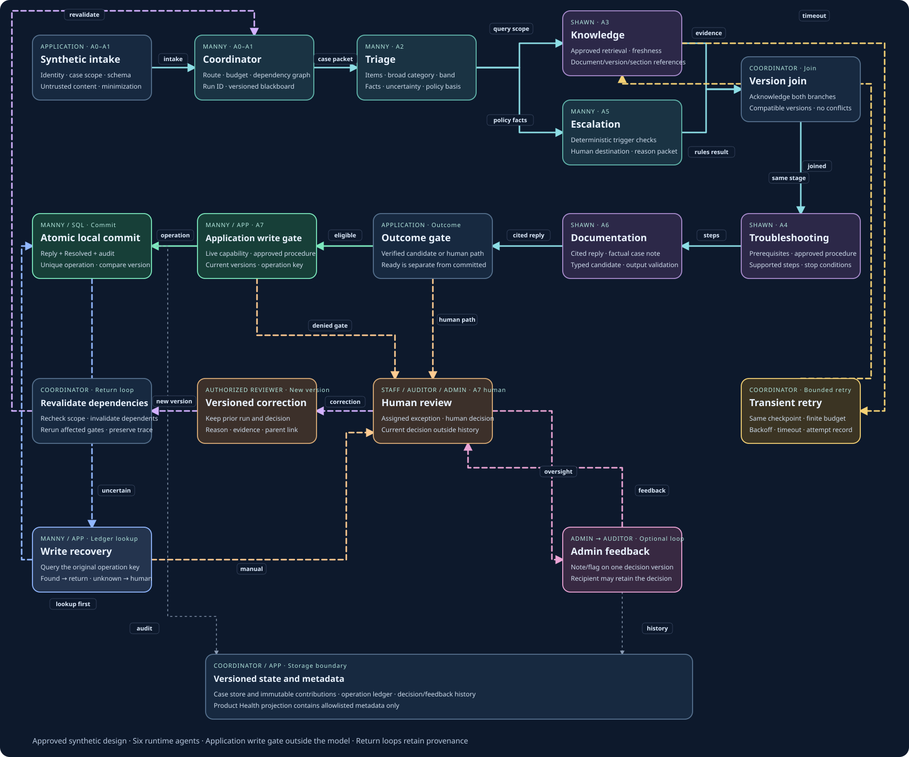
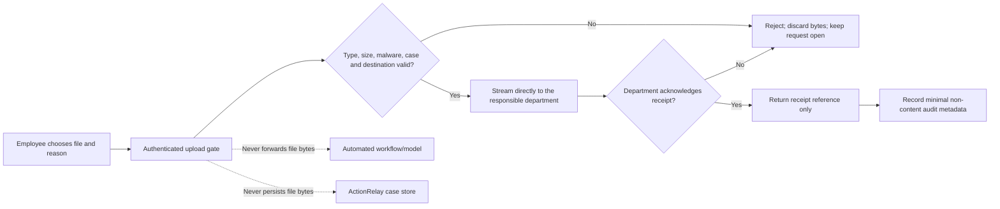

# ActionRelay by CDIT — Technical architecture

Approved requirements amendments recorded on 2026-11-10 and 2026-11-11. The local build contains authenticated synthetic flows, digest-checked resource delivery and atomic public-resource resolution. User or Admin can initiate one explicitly authorized live Triage call for a submitted synthetic request; User calls are restricted to the requester's own ticket and use a short-lived service session scoped to that case because the Coordinator accepts Staff/Admin workflow roles. Persisted runs are attributed to the authenticated requester. A current Auditor decision resumes local Knowledge, Troubleshooting, Escalation and Documentation in sequence. Persisted results are joined into one activity timeline by exact case version. User activity shows only stage states and bounded categories. Likely personal or sensitive details are blocked from provider dispatch. This connection needs synthetic end-to-end validation; personal-document department delivery is not implemented and production/CDIT readiness is not claimed.

[Full field guide](actionrelay-field-guide.html) · [Diagram explorer](actionrelay-architecture.html) · [Standalone SVG](actionrelay-architecture.svg) · [PRD-v4](../requirements/PRD-v4.md)

## Six agents and application responsibilities

Manny owns Coordinator, Triage, Escalation and SQL. Shawn owns Knowledge, Troubleshooting and Documentation. Application authorization, joins, commits, storage and human review do not introduce an additional runtime agent.

## Handoffs, internal checks and return loops

### Synthetic intake

Owner — Application · Gate — A0–A1

Input — Authenticated User request or scoped Staff case, current case version and synthetic-data marker.

Internal checks

- Resolve the active session and record scope.
- Validate allowed fields and separate untrusted content from policy.
- Minimize the case packet before specialist access.

Output — Validated intake artifact and immutable case/version reference.

Denial — Malformed input or unauthorized access returns rejected_input. Unsafe content blocks the checkpoint.

Return path — Corrected input starts a new version. Rejected input does not dispatch specialists.

### Coordinator

Owner — Manny · Gate — A0–A1

Input — Acknowledged intake artifact, actor scope, case version and versioned routing policy.

Internal checks

- Create run_id with parent_run_id for corrected cases.
- Set allowed stages, budgets and dependency requirements.
- Append state transitions and stop dependent work when a gate fails.

Output — Minimized, typed stage packets with expected versions and requested next checks.

Denial — Missing permission, invalid schema or stale state blocks execution. Coordinator cannot grant a capability.

Return path — Revalidation returns here after a reasoned correction. Transient retry preserves the same checkpoint identity.

### Triage

Owner — Manny · Gate — A2

Input — Case facts, item/source spans and versioned category/urgency policy.

Internal checks

- Segment only supported independent requests.
- Propose category, specific issue and Low/Medium/High band.
- Validate rationale, missing facts and claim labels against policy.

Output — Item-level classification proposal, unknowns, potential-urgent flags and eligibility facts.

Denial — Unknown classification routes to the Auditor. Unsupported or high-impact uncertainty cannot be forced into Low.

Return path — An accepted human correction creates a new case/decision version and revalidates Triage plus affected downstream stages.

### Knowledge

Owner — Shawn · Gate — A3

Input — Scoped issue, current approved-resource registry and source-policy versions.

Internal checks

- Retrieve relevant approved passages or resource mapping.
- Verify freshness, access restrictions and claim-level references.
- Treat retrieved text as evidence, never executable instructions.

Output — Verified evidence artifacts, source IDs/versions/sections and explicit gaps.

Denial — Missing, stale, restricted or conflicting sources abstain. A transient service timeout may use the retry path.

Return path — After bounded transient recovery, retry this same checkpoint. Source correction invalidates Knowledge and downstream dependents.

### Escalation

Owner — Manny · Gate — A5

Input — Validated case and Triage output, approved escalation policy. May run parallel with Knowledge.

Internal checks

- Evaluate must-escalate rules independently of model confidence.
- Preserve high-impact concerns and policy exceptions.
- Record the trigger, basis and proposed human destination.

Output — No-trigger result or minimized escalation packet with evidence and unresolved questions.

Denial — Must-escalate prevents automatic fulfillment. Unknown destination returns for human classification.

Return path — Changed category/band, impact facts or policy requires this check again before any new action.

### Version join

Owner — Coordinator · Gate — Join

Input — Knowledge and Escalation artifacts with acknowledged receipt and validation results.

Internal checks

- Match case_id, run_id, case_version and policy_version.
- Validate each source version for its own referenced document.
- Require both branches, preserve disagreements and reject late/stale results.

Output — Compatible evidence/policy bundle or explicit conflict and human question.

Denial — A transport acknowledgement does not prove evidence validity. Missing/late/conflicting outputs block dependent work.

Return path — A new run must not consume an older run’s late branch. Re-run the affected branch when corrected.

### Troubleshooting

Owner — Shawn · Gate — A4

Input — Version-matched evidence, policy and classification bundle.

Internal checks

- Map the complete request to supported procedure steps.
- Verify prerequisites, access and missing information.
- Check whether all items are supported and whether a stop condition applies.

Output — Source-supported steps and a bounded proposed action or clarification/human handoff.

Denial — Unsupported procedure, restricted record or unresolved prerequisite cannot become a fulfilled answer.

Return path — Changed evidence or case facts invalidate affected troubleshooting and later response assembly.

### Documentation

Owner — Shawn · Gate — A6

Input — Supported procedure, verified facts, source references and uncertainty.

Internal checks

- Assemble response/note without invented facts.
- Validate schema, required fields, citations and privacy.
- Preserve unknowns and identify the exact requested next outcome.

Output — Versioned response artifact and typed candidate, or reviewable draft with limitations.

Denial — Unsupported material claims, invalid schema or disallowed content suppress the automatic candidate.

Return path — Revised evidence or facts create a new response artifact. Earlier text remains attributable.

### Outcome gate

Owner — Application · Gate — Outcome

Input — Validated agent outputs, all-item completion, source/policy versions and stop flags.

Internal checks

- Require verified consequential facts for an automatic candidate.
- Check full-case completeness and absence of escalation/unknowns.
- Distinguish ready_for_authorized_action, ready_for_human_review and safe stops.

Output — Candidate for the live write gate or a scoped human/recovery packet.

Denial — Ready does not mean resolved. A false-ready state on a must-stop case fails acceptance.

Return path — Corrections run again through required gates. No human feedback can bypass the outcome gate.

### Application write gate

Owner — Manny / app · Gate — A7

Input — Typed candidate, live identity/capability, case version, approved procedure and current resource mapping.

Internal checks

- Recheck Low band and complete exact procedure match.
- Recheck source freshness, permissions and all-item outcome.
- Bind operation key to case/version, procedure, policy/source versions and response digest.

Output — Authorized local operation parameters, never model-generated SQL or an arbitrary destination.

Denial — Stale version, revoked permission, ambiguity, personal record or new safety trigger denies the write.

Return path — A denied write needs revalidation or human action. A changed case cannot reuse stale authority.

### Fixed resource catalog

Owner — Application · Gate — Exact resource match

Input — Whole-request normalized phrase and a fixed catalog key. The model cannot nominate an item, file, external URL, or action.

Internal checks

- Require a complete exact phrase from the allowlist; mixed or unrecognized requests do not match.
- Load only package-owned files. Check PDF signature, ending marker, size and pinned SHA-256 before delivery.
- Use a code-owned HTTPS URL for official public resources. Show the external destination clearly and state what it does not complete.
- Keep personal records, payroll changes and actual schedule-change requests on the human/HR path.

Output — Resource receipt and candidate case transition, scoped to the authenticated User’s own Submitted synthetic request.

Denial — Missing file, digest mismatch, stale case, unauthorized scope or no exact match leaves the case open.

Return path — An unavailable resource produces a bounded human-review reply; correction of the file/catalog requires a new verified build.

### Atomic local commit

Owner — Manny / SQL · Gate — Commit

Input — Gate-approved operation with expected case version and unique operation key.

Internal checks

- Begin a transaction and compare the current version.
- Insert cited reply, set Resolved, increment version and record audit/operation together.
- A duplicate key returns the recorded operation. A competing old-version candidate conflicts.

Output — action_committed with recorded operation ID and final case version.

Denial — Rollback applies none of the effects. Unknown acknowledgement does not authorize a second insert.

Return path — Uncertain commit enters ledger lookup. Report success only after verifying persistence.

### Human review

Owner — Staff / Auditor / Admin · Gate — A7 human

Input — Known facts, source references, unknowns, trigger and requested human decision.

Internal checks

- Enforce capability and assignment before writes.
- Auditor classifies or revises own latest assigned decision with a reason.
- Admin overrides require a reason. Closed cases remain read-only.

Output — Versioned decision, a separately stored requester-facing response, permitted lifecycle action, or correction submitted for a new run. Staff, Auditor and Admin never overwrite the submitted request text.

Denial — Auditor all-case Queue reads do not permit all-case response, classification or lifecycle writes. These writes require assignment; account and assignment changes remain Admin-only. A lifecycle change and its requester-facing response are committed together. Unknown classification cannot resolve or close a case.

Return path — A reasoned correction takes the new-version loop. Optional Admin feedback may leave the decision unchanged.

### Versioned correction

Owner — Authorized reviewer · Gate — New version

Input — New verified facts, revised classification or evidence correction.

Internal checks

- Save an explicit revision reason and expected previous version.
- Append actor/time/evidence and preserve all prior versions.
- Create a new run linked to its parent only when correction is submitted for processing.

Output — New case/decision version, parent_run_id and affected dependency set.

Denial — Stale revision cannot overwrite a newer decision. Auditor cannot supersede an Admin override.

Return path — Version-aware invalidation reruns affected checkpoints. No unreviewed rule promotion or online learning.

### Revalidate dependencies

Owner — Coordinator · Gate — Return loop

Input — Corrected version, parent run and dependency/provenance graph.

Internal checks

- Revalidate live actor/case scope and policy.
- Invalidate changed inputs and every downstream consumer.
- Reuse unaffected evidence only with current versions and dependency proof.

Output — Fresh acknowledged run inputs to Coordinator and required agent stages.

Denial — Late output from the parent run cannot advance the corrected run.

Return path — Returns to Coordinator. Category/band changes revalidate Triage and affected later work.

### Transient retry

Owner — Coordinator · Gate — Bounded retry

Input — A classified transient dependency failure with a retryable idempotent stage.

Internal checks

- Check configured attempt budget, delay, timeout and remaining run budget.
- Recheck authority and the same checkpoint version before retry.
- No hidden SDK retry or unapproved billable call.

Output — Recorded retry attempt to the failed checkpoint, or failed_dependency_manual_fallback.

Denial — Missing evidence, policy/permission failures, injection and schema errors do not retry as transient failures.

Return path — Illustrated Knowledge return is an example. Retry only the checkpoint that failed, not a full unbounded restart. Numeric budgets remain open.

### Write recovery

Owner — Manny / app · Gate — Ledger lookup

Input — Commit timeout, lost acknowledgement or duplicate request with original operation key.

Internal checks

- Read the operation ledger before considering a retry.
- If already committed, return that result without new side effects.
- If definitively absent, revalidate before retry. If uncertain, stop for recovery.

Output — Verified existing commit, newly validated retry, or unresolved manual path.

Denial — No blind replay, duplicate reply or fabricated success.

Return path — The retry arrow to commit means same-key recovery after revalidation, not new authority.

### Admin feedback

Owner — Admin → Auditor · Gate — Optional loop

Input — One case/decision-version ID and the exact author account.

Internal checks

- Only Admin posts notes, sets/clears flags or overrides.
- Bind feedback to the target decision version and preserve prior flag events.
- Expose the note to the author without requiring revision.

Output — Version-specific informational feedback and minimal operational audit metadata.

Denial — Feedback alone cannot alter classification, case status, assignment or start an agent run.

Return path — Auditor can leave the decision unchanged. An independently reasoned revision follows the correction loop.

### Versioned state and metadata

Owner — Coordinator / app · Gate — Storage boundary

Input — Correlated case/run/stage artifacts and application operations.

Internal checks

- Store only approved synthetic case content in the case store.
- Append acknowledged versioned contributions without replacing another agent’s output.
- Project bounded IDs, times, component/version, status/error codes and performance to Product Health.

Output — Traceable provenance, operation history and content-minimized operational views.

Denial — No request bodies, arbitrary prompts, notes, secrets, direct identities or attachments in Product Health.

Return path — Correction/retry/feedback histories remain distinct. Retention and reset follow PRD-v4 §4d.

## Connection inventory

| From | To | Packet or condition | Route |
| --- | --- | --- | --- |
| Synthetic intake | Coordinator | Validated intake | main |
| Coordinator | Triage | Case/version packet | main |
| Triage | Knowledge | Issue + source scope | main |
| Triage | Escalation | Facts + policy | main |
| Knowledge | Version join | Evidence + versions | main |
| Escalation | Version join | Trigger/no-trigger | main |
| Version join | Troubleshooting | Validated join | main |
| Troubleshooting | Documentation | Supported procedure | main |
| Documentation | Outcome gate | Cited response candidate | main |
| Outcome gate | Application write gate | All checks pass | auto |
| Application write gate | Atomic local commit | Bounded operation | auto |
| Outcome gate | Human review | Exception / unknown | human |
| Application write gate | Human review | Denied gate → review | human |
| Human review | Versioned correction | Reasoned correction | loop |
| Versioned correction | Revalidate dependencies | New case/run version | loop |
| Revalidate dependencies | Coordinator | Revalidate affected stages | loop |
| Human review | Admin feedback | Admin inspects version | feedback |
| Admin feedback | Human review | Optional feedback | feedback |
| Knowledge | Transient retry | Transient dependency only | retry |
| Transient retry | Knowledge | Same failed checkpoint | retry |
| Atomic local commit | Write recovery | Commit acknowledgement uncertain | recovery |
| Write recovery | Atomic local commit | Lookup → revalidate → same key | recovery |
| Write recovery | Human review | Unknown ledger result → human | human |
| Atomic local commit | Versioned state and metadata | Operation metadata | meta |
| Admin feedback | Versioned state and metadata | Versioned feedback history | meta |

## Authorization and consistency requirements

The complete Low-band request must match a versioned approved resource procedure. Verified facts, current sources, no stop trigger, all-item completion and live capability checks are required. Agents return a candidate. The application gate authorizes a fixed operation.

Reply, Resolved status, case-version increment and audit/operation record commit in one local transaction. A unique operation key and expected case version handle duplicates and concurrent candidates. An uncertain acknowledgement queries the ledger first. A found operation returns the same result. A definitively absent operation requires revalidation before retry. An inconclusive lookup stays unresolved.

Auditor is a capability on Staff. General Queue reads all cases including unassigned work. Classification writes remain assigned-only. Current decision appears outside earlier history. Revision requires a reason and expected previous version. Admin overrides require a reason, and Auditor cannot supersede an Admin override.

Admin feedback and flags bind to a case/decision version and its author. Feedback is optional to act on and does not change classification, assignment, lifecycle or a run. Only an independent submitted correction creates a new linked run.

## Data, analytics and evidence limits

Synthetic case/reply/decision content belongs in the permitted case store. Product Health receives allowlisted operational metadata only. Snapshot wheels count mutually exclusive status at cutoff including carryover. Matched-period activity counts events during the same calendar dates and may overlap. Historical outcome dates must come from transition events.

The authenticated local application and walkthrough use 400 synthetic development tickets based on repeated/paraphrased examples, dated across 2024–2026 and grouped into nine broad categories. Forty synthetic cases remain unclassified and are assigned to the Auditor for demonstration. These are not verified CDIT distributions or held-out acceptance labels. The walkthrough is a separate scripted presentation, not a live backend/model write.

## Employee resource library and personal-document delivery boundary

The authenticated common footer exposes a shared Forms & Resources library. It contains visibly synthetic workplace-policy, directory, vacation-request and complaint PDFs, plus direct links to the IRS, U.S. Department of Labor, New York Paid Family Leave and NYC IDNYC issuing sources. The directory catalog also lists the existing weekly timesheet and shift-pattern PDFs. A leave-form notice appears before an FMLA/PFL source opens. User-generated resources must be identified as such if introduced later.

Personal-document flow is a separate, future department-owned path; it must not branch through the six-agent workflow, the case-text record, Product Health, or model context:

The future path accepts only configured formats (DOCX, ODT, PDF, JPEG, PNG, and other explicitly approved types), validates content rather than trusting filename/MIME alone, enforces size limits, scans for malware, uses encrypted authenticated transport, and authorizes the exact department destination. The source filename and document contents are excluded from application logs and permanent ticket records. Department service accounts must be scoped to the intended department; unrelated Staff/Admin/Auditor queue access does not grant document access. Department-owned retention and handling rules apply after receipt.

If the destination is unavailable, unconfigured, or cannot confirm the correct department, the application rejects the upload, discards the in-flight bytes, leaves the case open, and directs the employee to the employer's approved secure channel. It must never mark a document sent or resolve the request based on an attempted transfer. The current local synthetic build has no upload endpoint or department connection and must not receive real personal documents. These controls are acceptance gates, not claims about a connected production service.

## Open implementation decisions

- Backend routine write integration — Implement and test the procedure registry, operation capability, transactional commit and duplicate/concurrent/uncertain-commit behavior.
- Permission implementation — Add server-side all-ticket Auditor reads while retaining assigned-only classifications, read-only account directory and Admin-only management.
- Feedback persistence — Implement exact recipient/version binding, immutable feedback/flag history and independent correction submission.
- Contracts and schema — Approve concrete stage/procedure/schema versions, lifecycle/operation storage, optimistic concurrency and recovery semantics.
- Retry and evidence thresholds — Choose finite attempts, delays/timeouts and permitted transient failures. Calibrate evidence/claim thresholds on a labeled holdout.
- Authorized CDIT sources — Obtain approved CDIT case data, knowledge, operational definitions and integration/data-flow approval for any future CDIT-data version.
- Historical document alignment — Earlier PRDs, the original guide, companion matrix and deferred decisions remain historical where they conflict with the 2026-11-10 amendment. PRD-v4 is authoritative for the bounded local scope.
- Release evidence — The presentation and this guide are requirements illustrations. Backend login, write gate, production identity, real integrations and live model completion are not established by their playback.

## Review method and artifact validation

The primary reader is a project reviewer tracing authority and failure recovery. Stable color/owner labels preserve recognition, selectable route views reduce overload, and the inspector exposes technical detail progressively. All loops stay visible at a reduced emphasis so path selection does not hide safety exits.

Large maps intentionally scroll horizontally on small screens. Native buttons and keyboard-accessible nodes provide component selection. Text labels and line styles supplement color. Print and Markdown export provide alternative reading formats. Browser validation covers navigation, search/filter, path playback/reset, detail inspection, downloads and narrow layout. No assistive-technology or user-research result is claimed.
